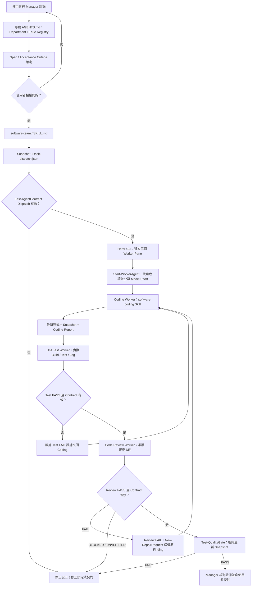

# Herdr AI Company｜作業流水線與文件責任對照

本文件說明 **任務從 Herdr Manager 的對話，經 Team / Worker Skills、專案規範、通訊契約，到品質驗收** 的實際路徑。每個步驟都標示由誰啟動、讀取哪些文件、執行哪些指令、產生哪些證據。

- **安裝與第一次操作**：[WORKSHOP.md](../WORKSHOP.md)
- **所有檔案應放的位置**：[FILE-PLACEMENT.md](FILE-PLACEMENT.md)
- **契約資料格式與欄位**：[contracts/README.md](../contracts/README.md)
- **實際驗收紀錄**：[ACCEPTANCE.md](ACCEPTANCE.md)

> **重要**：目前是 **Skill-Driven Orchestration**。Manager 依 Team Skill 主動呼叫 Herdr CLI 與 PowerShell；PowerShell 負責對實際送入的資料做確定性驗證，**並沒有額外的常駐 Controller，也不是安裝後自動觸發的 Herdr Hook**。

## 1. 先認識六類檔案：每類文件只負責一件事

| 元件 | 正確位置（安裝後） | 由誰使用 | 職責（不負責什麼） |
|---|---|---|---|
| Manager Bootstrap | `D:\AI-Company\bootstrap\manager-startup.md` | 主 Pane 的 Codex／Claude | 決定主責部門、何時派工；**不直接規定 C# 或書稿細部標準** |
| Team Skill | `D:\AI-Company\.agents\skills\software-team\SKILL.md` 或 `writing-team\SKILL.md` | Manager | 決定哪些 Worker、執行順序、重試與驗收關卡 |
| Team Router | `D:\AI-Company\.agents\skills\company-router\SKILL.md` | Manager（跨部門時） | 只處理 Guest Delegation；**不猜或改變 Department** |
| Worker Skill / References | `.agents\skills\<worker>\SKILL.md` 與同目錄 `references\*.md` | 各個 Worker Pane | SOP 與工作方法；**不儲存特定專案的技術規範** |
| Project `AGENTS.md` / Rules | `<ProjectRoot>\AGENTS.md`、`<ProjectRoot>\docs\team-rules\*.md` | Manager / Worker | 主責 `Department`、Rule Registry、專案技術／寫作標準 |
| Worker Model Configuration | `config\agent-models.json` + `scripts\Start-WorkerAgent.ps1` | Manager（讀配置並啟動 Worker） | 依 Worker Skill 選取獨立的 CLI Model／Effort；不變更 Manager、Spec 或專案 Rules |
| Contracts / Policies / Scripts | `contracts\`、`policies\`、`scripts\` | Manager / Worker / PowerShell | 統一欄位、界線、驗證與修復；**不是另一個 LLM Agent** |

有三份容易混淆的 `AGENTS.md`：

1. `$HOME\.codex\AGENTS.md`：Codex 使用者層級啟動橋接，指向公司 Manager Bootstrap。
2. `D:\AI-Company\AGENTS.md`：**維護公司設定庫**時才使用，沒有 Project Department。
3. `<ProjectRoot>\AGENTS.md`：**正在執行任務的專案**，唯一宣告 `Department` 與 `Rule Registry`。

## 2. 一張圖看完整 Software Pipeline



**三個 Pane 可以一起建立，但驗證是有依賴順序的**：完成穩定 Coding Checkpoint，才對該版本執行 Test 與 Review；一旦改檔，舊的 PASS 不再適用。

## 3. Software Pipeline：每一關的實際負責檔案

以下假設：

- 公司根目錄 `D:\AI-Company`（下文 `$C`）
- 專案根目錄 `D:\Workspaces\Software\Project-A`（下文 `$P`）
- 專案已經建立有效的 Spec（例如 `docs/specs/feature.md`）及驗收條件；若檔案路徑不同，依實際專案調整。

| 關卡 | 何時發生／發起者 | 必讀文件或規格 | 真正使用的指令／程式 | 輸出與下一關條件 |
|---|---|---|---|---|
| **0. Manager 啟動** | Herdr 主 Pane 開啟 Codex | `$HOME\.codex\AGENTS.md` → `bootstrap/manager-startup.md` | `codex`；環境自檢 | 確認自己是 Manager，不是 Worker |
| **1. 主責判定** | Manager 進入專案 | `<ProjectRoot>/AGENTS.md` | 讀 `Department: software` 與 `## Rule Registry` | 選 `software-team`；**不用 Router 猜測** |
| **2. Planning / Spec** | 使用者與 Manager | 專案 `AGENTS.md`、當次 Spec | 正常對話，保存 Spec / Acceptance | 沒有使用者開工授權，不建 Worker Pane |
| **3. Team 編排** | 使用者說「開始做吧」 | `.agents/skills/software-team/SKILL.md`、`contracts/STATE-MACHINE.md`、`policies/manager/git-commit.md` | Manager 啟用 Team Skill | 選定 Coding、Unit Test、Code Review；Repo Scout 按需 |
| **4. Dispatch 預檢** | Manager 準備每個 Worker 任務 | `contracts/schemas/task-dispatch.schema.json`、`contracts/worker-requirements.json`、`company-router/references/dispatch-contract.md` | `scripts/Get-ScopeSnapshot.ps1`、`scripts/Test-AgentContract.ps1 -Type Dispatch` | 合法 `dispatch-*.json`；**無效不得派工** |
| **5. Pane / CLI 啟動** | Manager | `.agents/skills/company-router/references/runtime.md`、`config/agent-models.json`、**STEP 3 全域安裝的官方 `herdr` Skill** | `herdr pane split`、`scripts/Start-WorkerAgent.ps1`（內部呼叫 `herdr agent start` 並套用 Model/Effort）、`herdr agent prompt` | 各獨立 Worker Pane 取得**已驗證 Dispatch 路徑 + Worker Skill 名稱** |
| **6. Coding** | Coding Pane（Codex CLI） | `software-coding/SKILL.md`、`references/implementation.md`、公司 Worker Policies、專案 Rule | CLI 按 Skill 實作；計算 Snapshot；產出完整 Report | 新程式、穩定 Checkpoint、`worker-report.json` |
| **7. Unit Test** | Manager 取得 Coding Checkpoint 後派工 | `software-unit-test/SKILL.md`、`references/test-execution.md`、專案 Testing Rule | 真正的 Build/Test 命令；`scripts/Test-AgentContract.ps1 -Type Report` | 測試 Exit Code、Log、有效 PASS 才進 Review |
| **8. Code Review** | Test 有效後派工 | `software-code-review/SKILL.md`、三份 Review References、專案 Rule、實際 Diff | 唯讀 Codex CLI；`scripts/Test-AgentContract.ps1 -Type Report` | PASS／FAIL／BLOCKED；保存**Reviewer 原始 JSON** |
| **9. FAIL 修復** | Test/Review 有 Blocking Finding | `contracts/STATE-MACHINE.md`、原始 FAIL Report、修復 Schema | `scripts/New-RepairRequest.ps1`、`scripts/Test-AgentContract.ps1 -Type Repair` | 相同 Finding ID 返回 Coding，修復後建立**新 Snapshot** |
| **10. Quality Gate** | 必要角色的最新報告齊全 | `contracts/README.md`、各 Worker Reports | `scripts/Test-QualityGate.ps1` | Coding + Test + Review 全部有效 PASS、相同**目前** Snapshot |
| **11. Owner 驗收** | Manager | Spec／驗收條件、實際 Diff、Build/Test Log、契約報告 | 人工／Manager 核對真實證據；僅使用者授權才 Commit | 向使用者報告成果、限制與未解決事項 |

**說明：** Test FAIL 依實際測試失敗證據退回 Coding；Review FAIL 且存在 Blocking Findings 時才使用 `scripts/New-RepairRequest.ps1` 封存並交接 Reviewer 原始意見。Team Skill 負責「應何時呼叫哪些工具」；`scripts/*.ps1` 負責「被呼叫時實際驗證資料」。腳本不會自行理解使用者需求，也不會自動開 Herdr Pane。

### Worker 模型與角色的實際綁定

Team Skill 負責決定**誰應被啟動**；`config/agent-models.json` 決定**新 Worker 的模型與推理強度**；`scripts/Start-WorkerAgent.ps1` 在已建立的空 Shell Pane 中，實際呼叫 Herdr `agent start` 並傳入原生 CLI 參數。這不會改變主 Pane Manager 的模型，也不會重新解釋 Worker Skill／Project Rule。

```powershell
$C = 'D:\AI-Company'
# 預覽（只讀取並驗證設定，不啟動 CLI）
& "$C\scripts\Start-WorkerAgent.ps1" -CompanyRoot $C -WorkerSkill software-coding -Preview
# 由 Manager 取得真正的 PaneId 與合法 AgentName 後正式啟動
& "$C\scripts\Start-WorkerAgent.ps1" -CompanyRoot $C -WorkerSkill software-coding -AgentName $codingName -PaneId $codingPane
```

模型選擇須在建立新 Worker Session 時生效；已存在的 Worker 不能只修改 JSON 就當成熱切換成功。詳見 [config/README.md](../config/README.md)。

## 4. Worker 接到 Dispatch 後，究竟怎麼找到 Rule？

以下是每位 Worker 都必須遵循的載入順序，**不是 Manager 把所有 Rule 貼進 Prompt**：

```text
Herdr Worker Pane：獨立 Codex / Claude CLI
    ↓ 收到 WORKER_CONTRACT（已驗證的 dispatch JSON 絕對路徑）
自己的 <worker>/SKILL.md              ← 定義 SOP
    ↓
自己的 <worker>/references/*.md       ← 定義具體執行方法
    ↓
D:\AI-Company\policies\worker\      ← rule-composition / worker-boundary / report-contract
    ↓
D:\AI-Company\contracts\worker-requirements.json  ← 必要 Rule Keys / Method References
    ↓
<ProjectRoot>\AGENTS.md              ← Department + Rule Registry
    ↓
<ProjectRoot>\docs\team-rules\*.md  ← 當前專案真正適用的規範
    ↓
實作 / 審查 / 測試 → 獨立 Worker Report（附 Rule IDs 與 SHA-256）
```

### Software Worker 責任表

以下 Required Rule Keys 以 [`contracts/worker-requirements.json`](../contracts/worker-requirements.json) 為準；表格只是便於閱讀，修改設定時必須同步核對。

| Worker Skill | SOP／方法文件（相對於 Skill 目錄） | 必須載入的 Project Rule Keys | 權限與證據 |
|---|---|---|---|
| `software-coding` | `references/implementation.md` | `software.architecture`、`software.coding`、`software.security` | 可在授權範圍實作；回報變更、實際命令、Snapshot |
| `software-unit-test` | `references/test-execution.md` | `software.testing`、`software.architecture` | 執行真實 Build/Test，附 Exit Code、Log；不修改 Production Code |
| `software-code-review` | `references/architecture-review.md`、`code-quality-review.md`、`test-review.md` | `software.architecture`、`software.coding`、`software.review`、`software.testing`、`software.security` | **真正 read-only**；獨立讀 Diff、測試證據、原始 Finding |
| `software-repo-scout`（選用） | `references/repo-discovery.md` | `software.architecture` | 唯讀探索依賴與影響範圍；不實作 |

Project-A 中例如 `software.review → docs/team-rules/code-review.md`。**這個對應關係來自 Project-A 的 `AGENTS.md`，不是公司 Skill 預設所有專案都使用同一套 C# 規範。**

## 5. 三種 Agent Communication Contract 與 PowerShell 介入點

每個 Run 的契約與證據放**目前專案**，而不是公司共用 Skill 目錄：

```text
<ProjectRoot>\.ai-work\runs\<run-id>\
├── spec.md                    ← 當次核准需求（名稱可依專案調整）
├── dispatch-coding.json       ← Manager 派工；先驗證
├── dispatch-test.json
├── dispatch-review.json
├── coding-report.json         ← Worker 完整回報
├── test-report.json           ← 包含實際執行證據
├── review-fail.json           ← 原始 FAIL，保留不覆寫
├── repair-02.json             ← 從原始 FAIL 精確複製 Blocking Findings
├── review-final.json          ← 修復後重新審查
└── evidence\                  ← 真正的測試輸出或核准的佐證檔
```

以上是**示範命名**，不是安裝時預先存在的檔案；實際輸出檔名需與 Dispatch 的 `report_path` 一致。

| 交接事件 | 格式的唯一來源 | 實際工具 | 成功與失敗的處理 |
|---|---|---|---|
| **Task Dispatch** | `contracts/schemas/task-dispatch.schema.json` | `scripts/Test-AgentContract.ps1 -Type Dispatch` | 無效不得送往 Worker |
| **Worker Report** | `contracts/schemas/worker-report.schema.json` | `scripts/Test-AgentContract.ps1 -Type Report` | `PASS` 僅代表該 Worker；`FAIL / BLOCKED / UNVERIFIED` 不得當成完成 |
| **Repair Request** | `contracts/schemas/repair-request.schema.json` | `scripts/New-RepairRequest.ps1` + `scripts/Test-AgentContract.ps1 -Type Repair` | 原始 Finding／來源 Hash 被更動即拒絕；修復後重驗 |
| **Snapshot** | `contracts/README.md`、`contracts/STATE-MACHINE.md` | `scripts/Get-ScopeSnapshot.ps1` | Scope 的 Source / Tests / Spec / Rules 變動，舊 PASS 作廢 |
| **Final Gate** | `contracts/STATE-MACHINE.md`、Team Skill | `scripts/Test-QualityGate.ps1` | 全部指定必要 Worker 有效 PASS，且同一最新 Snapshot 才能進入 Owner 驗收 |

### 可直接執行的檢查指令（PowerShell 7.4+）

```powershell
$C = 'D:\AI-Company'
$P = 'D:\Workspaces\Software\Project-A'

# 1) 安裝及專案規範檢查：在 tests 目錄
& "$C\tests\Verify-Structure.ps1" -Company $C
& "$C\tests\Verify-RuleRegistry.ps1" -ProjectRoot $P
& "$C\tests\Run-ContractTests.ps1" -CompanyRoot $C

# 2) 正式執行時的內容快照：在 scripts 目錄
# 只列已存在且真正涵蓋受檢內容的路徑；若 src 尚未建立，先不要填入。
& "$C\scripts\Get-ScopeSnapshot.ps1" -ProjectRoot $P -ScopePaths @('AGENTS.md', 'docs/team-rules')

# 3) Manager 已產生實際 Dispatch JSON 後，才驗證；不是安裝時可直接執行的指令
$Run = 'RUN-001'  # 換成當次真正建立的 Run ID
$D = Join-Path $P ".ai-work\runs\$Run"
& "$C\scripts\Test-AgentContract.ps1" -Type Dispatch -File "$D\dispatch-coding.json" -CompanyRoot $C -ProjectRoot $P

# 4) Worker 完整回報封存後，才驗證該 Report
& "$C\scripts\Test-AgentContract.ps1" -Type Report -File "$D\coding-report.json" -CompanyRoot $C -ProjectRoot $P
```

**最後兩個命令須有有效的 JSON 檔才可執行**。不應為了讓測試過關而編造 Dispatch、Rule Hash 或測試結果。

若 Reviewer **真正回報 FAIL 且帶 Blocking Findings**，由 Manager 執行以下交接；三份最終報告都存在、有效且同一最新版之後，才執行 Gate：

```powershell
# 以下延續上方的 $C、$P、$D，所列檔案都必須已實際建立
& "$C\scripts\New-RepairRequest.ps1" `
  -SourceReport "$D\review-fail.json" -DispatchFile "$D\dispatch-coding.json" `
  -CompanyRoot $C -ProjectRoot $P `
  -OutFile "$D\repair-02.json" -TargetWorkerSkill software-coding

& "$C\scripts\Test-AgentContract.ps1" -Type Repair `
  -File "$D\repair-02.json" -CompanyRoot $C -ProjectRoot $P

# Coding 修復後，必須重新計算 Snapshot、重新 Test 與 Review，產生三份最新 PASS
& "$C\scripts\Test-QualityGate.ps1" `
  -CompanyRoot $C -ProjectRoot $P `
  -ReportFiles @("$D\coding-final.json","$D\test-final.json","$D\review-final.json") `
  -RequiredWorkerSkills @('software-coding','software-unit-test','software-code-review')
```

**這不是可以一鍵跑完的範例**：`review-fail.json` 與三份 `*-final.json` 必須是 Worker 真實產出的報告，且所有命令必須按照流程分階段執行。包含各種負向案例的完整操作見 [CONTRACT-TEST.md](CONTRACT-TEST.md)。

## 6. Writing Team 的流水線

寫書專案的 `AGENTS.md` 必須是 `Department: writing`；Manager 直接執行 [`writing-team/SKILL.md`](../.agents/skills/writing-team/SKILL.md)，只在本次工作需要時才動用相關人員。

| 階段 | 負責者／主要文件 | 產出／規定 |
|---|---|---|
| 討論、Outline、Brief | Writing Manager + `<ProjectRoot>/AGENTS.md` | 確認受眾、章節目標、稿件範圍、驗收條件；尚不建立 Worker |
| 委派寫作 | `writing-team/SKILL.md` + `task-dispatch` | 依必要角色建立 Pane，Writer 執行 `writing-writer/SKILL.md` + `references/drafting.md` |
| 初稿提交 | Writer 讀 `writing.style`、`writing.editorial` | 產生初稿與 Report，不能無授權覆寫原稿 |
| 稿件審查 | `writing-editor` + `references/editorial-review.md` | 讀 `writing.editorial`、`writing.style`；標出結構與論證問題 |
| 事實查核（按需要） | `writing-fact-check` + `references/claim-verification.md` | 讀 `writing.facts`、`writing.sources`；查證不足回 `UNVERIFIED` |
| 校稿（按需要） | `writing-proofreader` + `references/proofreading.md` | 讀 `writing.proofreading`、`writing.style`；核對術語與格式 |
| 資料研究（按需要） | `writing-researcher` + `references/research-method.md` | 讀 `writing.sources`、`writing.facts`；不得虛構來源 |
| FAIL → 修訂 | Editor／Checker 原始 Report → `scripts/New-RepairRequest.ps1` → Writer | 保留原 Finding ID，產生新版稿件與 Snapshot、重做必要審稿 |
| Writing Gate | `scripts/Test-QualityGate.ps1` + 本次宣告必要角色 | 只有最新版必要角色都有效 PASS，Writing Manager 才能定稿 |

**規範來源一律是當前書籍專案**，例如 `writing.style → Book-A/docs/team-rules/style.md`，而不是公司共用的寫作偏好。

## 7. 寫書時調派 Software Guest（跨部門）

```text
Book-A AGENTS.md：Department: writing
    ↓
Writing Manager 是唯一 Owner
    ↓ 本次交付需要可執行的 C# 範例
company-router/SKILL.md + references/cross-department-*.md
    ↓ 在 Book-A 儲存 XDEPT Delegation 與 Guest Dispatch
Software Guest：Coding → Unit Test → Code Review
    ↓ 每個 Guest Worker 仍讀 Book-A AGENTS.md 的 software.* Rule Keys
Guest Reports + scripts/Test-QualityGate.ps1
    ↓
Writing Manager 記錄 SUBTASK_PASSED，再整合書稿與執行 Writing Gate
```

**不得**改 Book-A `Department`、跨到 Project-A 工作、讓 Software Guest 擔任第二位 Manager，或把程式範例 Gate 當成整章書稿的 Gate。參閱 [CROSS-DEPARTMENT-TEST.md](CROSS-DEPARTMENT-TEST.md)。

## 8. `scripts` 與 `tests` 的界線（請依用途找檔）

| 資料夾 | 哪些檔案 | 誰在什麼時候執行 |
|---|---|---|
| **`scripts/`** | `scripts/Get-ScopeSnapshot.ps1`、`scripts/Test-AgentContract.ps1`、`scripts/New-RepairRequest.ps1`、`scripts/Test-QualityGate.ps1` | **正式任務流水線**，由 Manager 依 Team Skill 在對應關卡呼叫 |
| **`tests/`** | `Verify-Structure.ps1`、`Verify-RuleRegistry.ps1`、`Run-ContractTests.ps1` | **安裝檢查、專案設定驗證、離線合成測試**；不執行真實 AI 任務 |

`tests/Run-ContractTests.ps1` 會使用 `scripts/` 的正式工具跑**合成正反例**，不代表真實 Code Review 或 Build/Test 通過。這兩個目錄應完整保留在 `D:\AI-Company`，**不要把公司 Scripts 搬到每個專案裡**。

## 9. 出錯時看哪份檔案？

| 看見的現象 | 第一個檢查點 | 預期處理 |
|---|---|---|
| Manager 不知道專案是哪個部門 | `<ProjectRoot>/AGENTS.md`、`bootstrap/manager-startup.md` | Department 必須唯一且合法 |
| 「開始做吧」卻沒開 Pane | Team Skill、`company-router/references/runtime.md`、全域安裝的官方 `herdr` Skill | 核對 Skill 是否真正載入、Herdr CLI 是否回 Pane ID |
| Worker 沒按 SOP 或亂用別的專案 Rule | `<worker>/SKILL.md`、`references/`、`contracts/worker-requirements.json`、Project Rule Registry | 缺失／衝突回 `BLOCKED`，不可自行替代 |
| Worker 說 PASS，但找不到證據 | `worker-report.json`、真實測試 Log、`scripts/Test-AgentContract.ps1` | JSON 合法仍不足以證明工作已執行 |
| Review FAIL 後 Coding 不知如何修復 | 原始 Review JSON + `scripts/New-RepairRequest.ps1` | 依原始 Finding ID 精確交接，不改寫 |
| 修復後 Review 仍被視為通過 | `scripts/Get-ScopeSnapshot.ps1`、`scripts/Test-QualityGate.ps1` | 新版本必須重新取得最新 PASS |
| Book-A Guest 讀到 Project-A Rule | Book-A `AGENTS.md`、XDEPT Delegation、`company-router/SKILL.md` | 停止，重新以 Book-A 的 Rule Registry 派工 |

**端到端成功的必要證據**：真實的 Pane／Agent ID、Worker Skill 與 Rule 載入紀錄、原始 JSON、實際檔案差異、Build/Test/來源證據，以及通過最新版本的 Gate。靜態檔案檢查不能取代這些證據。
